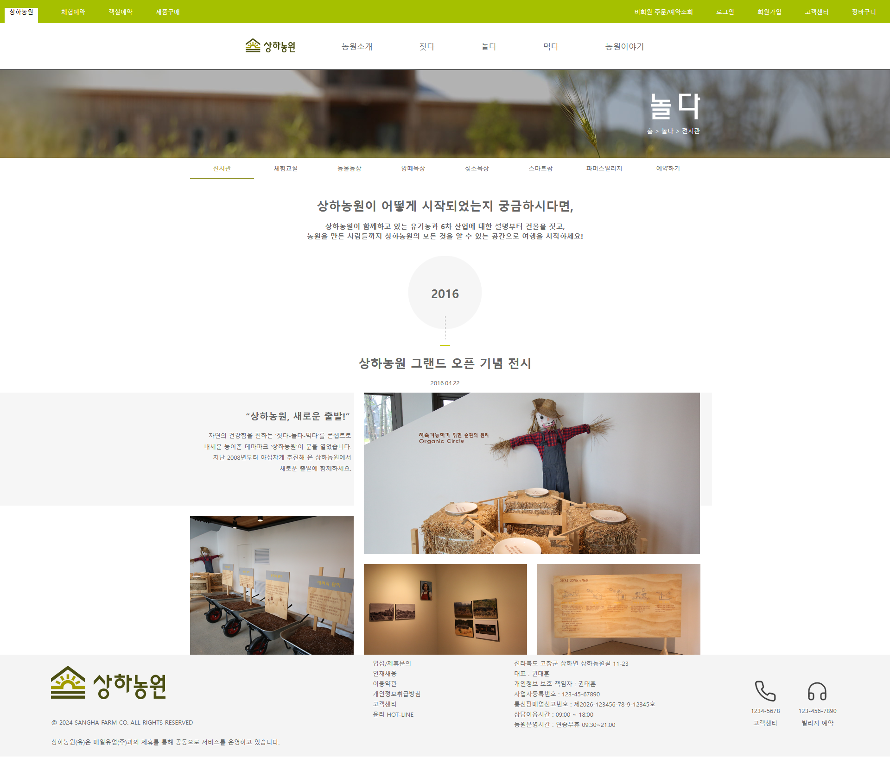
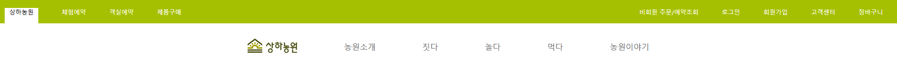
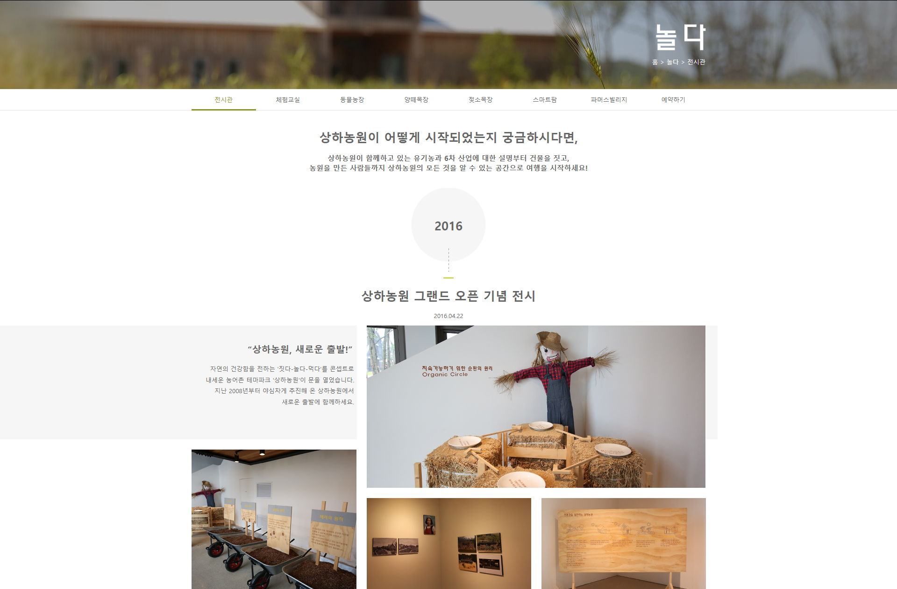
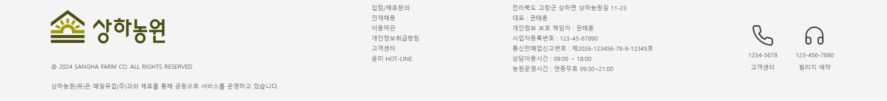

# Frontend-Clone-Coding-Sanghafram

상하농원 웹사이트 중 **놀다(전시관)** 페이지와 공통 **헤더·푸터**를 HTML과 CSS로 재현한 클론 코딩입니다.

- 참고 사이트: https://www.sanghafarm.co.kr/brand/play/gallery.jsp
- 원본 팀 프로젝트: https://github.com/tuski0/KANT_Sangha_Clone_Coding

## 사용 기술

| 기술 | 사용 내용 |
| ---- | --------- |
| HTML | 헤더 메뉴, 전시관 소개, 연도 표시, 전시 이미지·설명, 푸터 구조 |
| CSS  | 글꼴·색상·간격 설정, Flexbox 레이아웃, 배경 이미지 |

별도 설치나 빌드 없이 `play.html`을 브라우저로 열면 됩니다.

## 폴더 구조

```text
├── README.md
├── play.html                  # 놀다 — 전시관
├── public/                    # README 스크린샷
├── css/
│   ├── public_css/
│   │   ├── header.css         # 헤더 스타일
│   │   └── footer.css         # 푸터 스타일
│   └── play_css/
│       └── gallery.css        # 전시관 본문 스타일
└── img/
    ├── main_images/           # 헤더·푸터 로고, 전화 아이콘
    └── play_images/           # 전시관 배경·이미지
```

## 화면 구성

| 영역 | 내용 |
| ---- | ---- |
| 헤더 | 로고, 대메뉴(농원소개·짓다·놀다·먹다·농원이야기 등), 회원가입·예약 링크 |
| 본문 | 전시관 상단 배너, 소개 문구, 2016 연도 표시, 그랜드 오픈 기념 전시 이미지와 설명 |
| 푸터 | 로고, 연락처, 회사 정보 |

## 스크린샷

### 전체 화면



### 헤더



### 본문



### 푸터



## 참고

- 다른 페이지는 이 저장소에 포함하지 않았으므로 헤더 메뉴 링크는 모두 `#`으로 두었습니다.
